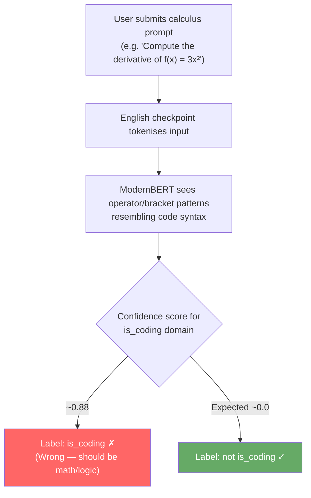
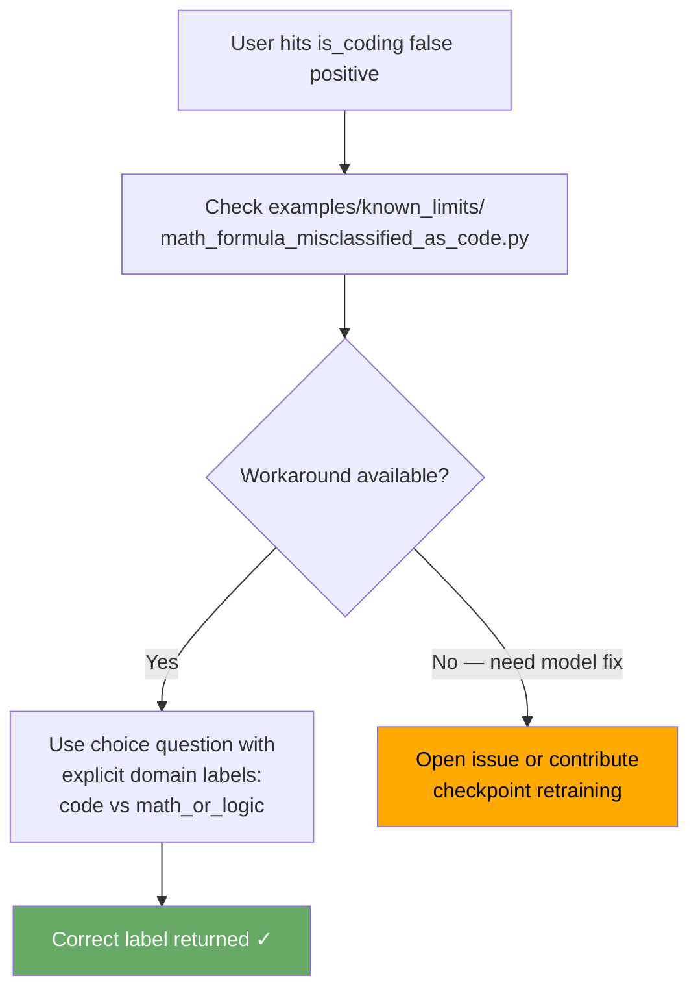

# PR #1087: Document math formula mis-scored as code (Issue #622)

## Issue

**Repository:** NandhaKishorM/laya  
**Issue:** [#622 — English checkpoint false-positive: calculus prompt scored as `is_coding`](https://github.com/NandhaKishorM/laya/issues/622)

The English checkpoint (ModernBERT) scores calculus prompts such as:

> "Compute the derivative of f(x) = 3x² + 2x"

as `is_coding` with ~0.88 confidence. The multilingual checkpoint (mmBERT) scores the same prompt near 0. Formula syntax (brackets, operators, single-letter variables) is visually similar to code, causing the model to conflate the two domains.

---

## Problem Flow



---

## Modification Made

Added `examples/known_limits/math_formula_misclassified_as_code.py` — a runnable, self-documenting script that:

1. Demonstrates the false positive with a concrete calculus prompt.
2. Shows the workaround: use `choice` question type with explicit domain labels (`code` vs `math_or_logic`) so the model can disambiguate.
3. Updated the README **Honest limits** section with a pointer to this example.

---

## Fix Flow



---

## Files Changed

| File | Change |
|------|--------|
| `examples/known_limits/math_formula_misclassified_as_code.py` | New — runnable demo + workaround |
| `README.md` | Added bullet in **Honest limits** section linking to example |

---

## PR Description

> ### What changed
>
> Added `examples/known_limits/math_formula_misclassified_as_code.py` — a runnable example demonstrating the known false positive where the English checkpoint scores calculus prompts as coding-related (~0.88 confidence).
>
> Also added a bullet to the README **Honest limits** section pointing to the new example.
>
> ### Why
>
> Issue #622 identified that the English checkpoint conflates formula syntax with code. The workaround (named domain labels) was noted in the issue but lacked a concrete runnable example for contributors and users.
>
> ### How it was verified
>
> ```
> python3 -m compileall -q examples/known_limits/
> ruff check examples/known_limits/math_formula_misclassified_as_code.py --select=E9,F63,F7,F82,F401,F811 --line-length=120
> ```
>
> Both pass with no output.
>
> ### Omissions
>
> Does not retrain or modify the checkpoint — the model limitation is a known trade-off documented in the README.
>
> Addresses NandhaKishorM/laya#622
