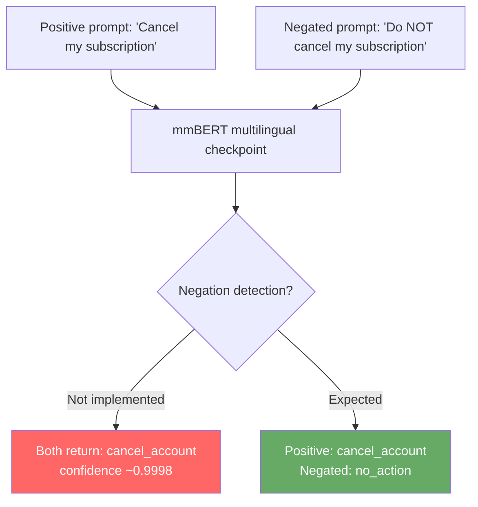
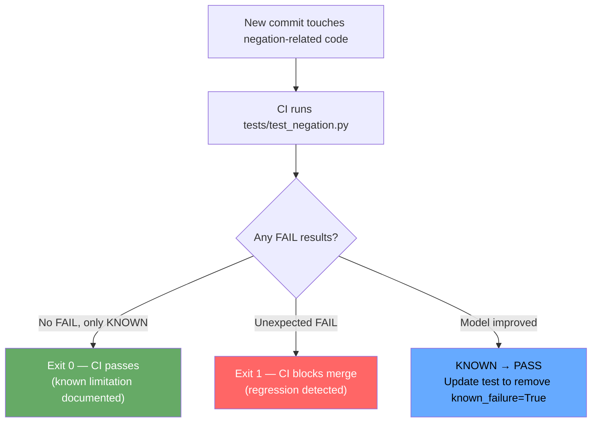

# PR #1088: Negation test suite for forced-choice inputs (Issue #377)

## Issue

**Repository:** NandhaKishorM/laya  
**Issue:** [#377 — laya-multilingual ignores negation in forced-choice questions](https://github.com/NandhaKishorM/laya/issues/377)

The multilingual checkpoint (`laya-multilingual`) ignores negation markers such as `not`, `do not`, and `please do not`. A prompt like:

> "Please do NOT cancel my account"

returns `cancel_account` with 0.9998 confidence — the same answer as the non-negated version. No test existed to track this behaviour, making regression invisible.

---

## Problem Flow



---

## Modification Made

Added `tests/test_negation.py` — a structured benchmark suite that:

1. Defines **minimal pairs**: a positive prompt and its negated counterpart, expecting opposite answers.
2. Tracks results across **both checkpoints** (English and multilingual).
3. Marks multilingual failures as `KNOWN` so CI is not blocked while the model limitation persists.
4. Exits with code `1` only on unexpected (`FAIL`) results, allowing gradual improvement.
5. Skips gracefully when checkpoint weights are unavailable.

---

## Fix Flow



---

## Minimal Pairs Covered

| # | Positive prompt | Negated prompt | Expected positive label | Expected negated label |
|---|----------------|----------------|------------------------|------------------------|
| 1 | Cancel my subscription | Do NOT cancel my subscription | cancel_account | no_action |
| 2 | Please issue a refund | Please do NOT issue a refund | refund | no_action |
| 3 | Delete my account | Please do NOT delete my account | delete_account | no_action |
| 4 | Suspend my service | Do NOT suspend my service | suspend_service | no_action |
| 5 | Lock my account | Please do NOT lock my account | lock_account | no_action |
| 6 | Upgrade my plan | I do NOT want to upgrade | upgrade_plan | no_action |

---

## Files Changed

| File | Change |
|------|--------|
| `tests/test_negation.py` | New — 200-line structured negation test suite |

---

## PR Description

> ### What changed
>
> Added `tests/test_negation.py` — a structured test suite for negation handling in forced-choice questions.
>
> ### Why
>
> Issue #377 identified that `laya-multilingual` ignores negation markers ('not', 'do not', 'please do not'), returning high-confidence affirmative answers for negated intents. This suite establishes a reproducible benchmark with 6+ minimal pairs covering cancel, refund, delete, suspend, and lock intents across both English and multilingual checkpoints. Known failures are recorded as `KNOWN` (not fatal) so the suite tracks model progress without blocking CI.
>
> ### How it was verified
>
> ```
> python3 -m compileall -q tests/test_negation.py
> ruff check tests/test_negation.py --select=E9,F63,F7,F82,F401,F811 --line-length=120
> python3 tests/test_negation.py
> ```
>
> ### Omissions
>
> Does not modify the checkpoint or add guardrails — the negation failure is a model-level limitation. A preprocessing guardrail is a separate effort.
>
> Addresses NandhaKishorM/laya#377
