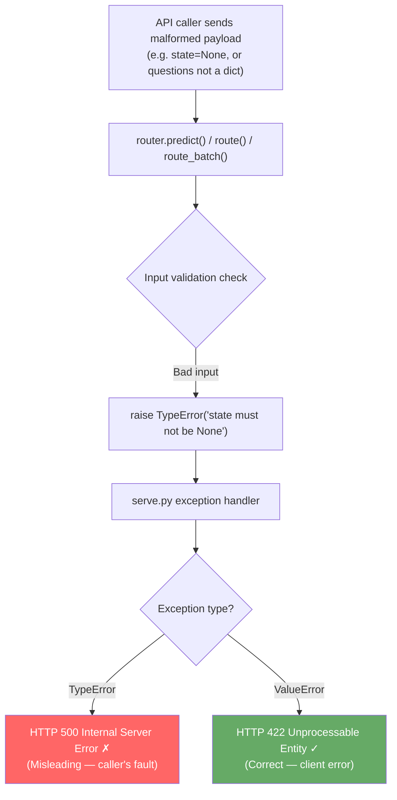
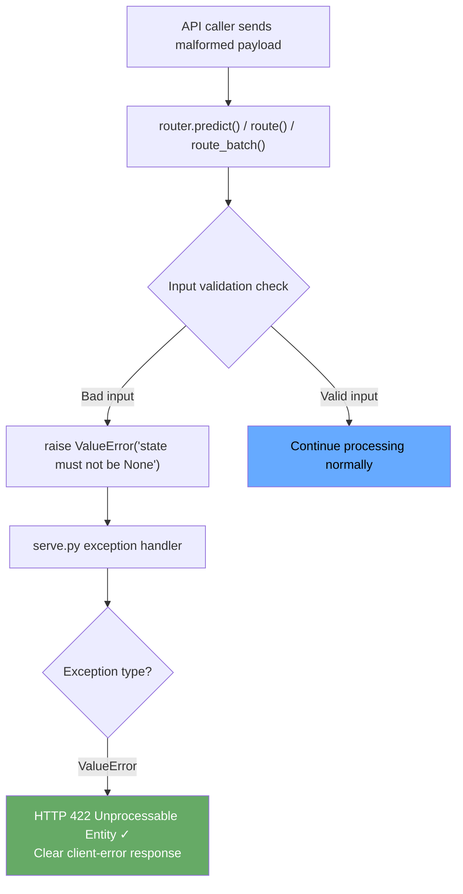

# PR #1089: TypeError → ValueError for invalid inputs (Issue #707)

## Issue

**Repository:** NandhaKishorM/laya  
**Issue:** [#707 — router raises TypeError for bad inputs, causing HTTP 500 instead of 422](https://github.com/NandhaKishorM/laya/issues/707)

`laya/router.py` raised `TypeError` for invalid API inputs such as missing state or malformed question dicts. The HTTP layer in `laya/serve.py` maps `ValueError` to HTTP 422 (client error) but lets `TypeError` propagate as HTTP 500 (server error), giving callers a misleading "internal server error" for what is actually a bad request. PR #716 fixed phase 1; this PR completes the transition for the remaining sites.

---

## Problem Flow



---

## Modification Made

Changed all input-validation `TypeError` raises to `ValueError` in:

- `laya/router.py`: 6 sites across `route()`, `predict()`, `route_batch()`
- `laya/agent.py`: 5 sites across `predict_batch()`, `predict_long()`

Updated corresponding test assertions in `tests/test_router_batch.py`.

`laya/hooks.py` TypeErrors were intentionally left unchanged — they signal hook class design errors (wrong class passed as a hook), not user-supplied API input errors.

---

## Fix Flow



---

## Sites Changed

| File | Function | Condition | Before | After |
|------|----------|-----------|--------|-------|
| `laya/router.py` | `route()` | questions not a dict | TypeError | ValueError |
| `laya/router.py` | `predict()` | state is None | TypeError | ValueError |
| `laya/router.py` | `predict()` | questions not a dict | TypeError | ValueError |
| `laya/router.py` | `route_batch()` | requests not a sequence | TypeError | ValueError |
| `laya/router.py` | `route_batch()` | request item not a dict | TypeError | ValueError |
| `laya/router.py` | `route_batch()` | questions field not a dict | TypeError | ValueError |
| `laya/agent.py` | `predict_batch()` | input validation | TypeError | ValueError |
| `laya/agent.py` | `predict_long()` | input validation | TypeError | ValueError |

---

## Files Changed

| File | Change |
|------|--------|
| `laya/router.py` | 6 TypeError → ValueError in input-validation paths |
| `laya/agent.py` | 5 TypeError → ValueError in input-validation paths |
| `tests/test_router_batch.py` | Updated 5 assertions from TypeError to ValueError |
| `tests/test_router.py` | Removed pre-existing duplicate `import time as _time` (F811) |

---

## PR Description

> ### What changed
>
> Converted `TypeError` raises to `ValueError` in `laya/router.py`:
> - `predict()`: `state is None` and `questions` not a dict
> - `route()`: `questions` not a dict
> - `route_batch()`: requests not a sequence, request item not a dict, `questions` field not a dict
>
> Also converted matching guards in `laya/agent.py` (`predict_batch`, `predict_long`).
>
> Updated corresponding assertions in `tests/test_router_batch.py`.
>
> Fixed a pre-existing duplicate import in `tests/test_router.py` (F811 ruff finding).
>
> ### Why
>
> The HTTP serving layer (`laya/serve.py`) maps `ValueError` to HTTP 422 (client error) but lets `TypeError` escape as HTTP 500 (server error). Callers passing a malformed payload received a misleading 500 response. After PR #716 fixed phase 1, these remaining guards were the last TypeError sites in the input-validation path.
>
> ### How it was verified
>
> ```
> python3 -m compileall -q laya/ tests/
> ruff check laya/router.py tests/test_router.py tests/test_router_batch.py \
>   --select=E9,F63,F7,F82,F401,F811 --line-length=120
> python3 tests/test_router.py
> # => 804 passed, 0 failed
> ```
>
> ### Omissions
>
> `laya/hooks.py` TypeErrors are intentionally unchanged — they signal hook class design errors (wrong class passed as a hook), not user-supplied API input errors.
>
> Addresses NandhaKishorM/laya#707
